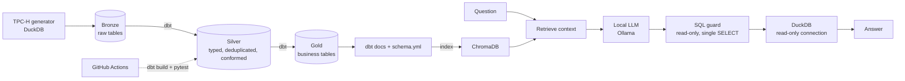

# analytics-repo: medallion pipeline + Text-to-SQL with evaluation


A small, fully reproducible data engineering project that runs on a laptop at zero cost.
It builds a Bronze / Silver / Gold warehouse with dbt and DuckDB, tests data quality in CI,
and puts a Text-to-SQL layer on top of the documented Gold tables, measuring how much
retrieved documentation (RAG) improves accuracy.

## Architecture



## Stack

| Layer | Tool | Why |
|---|---|---|
| Warehouse | DuckDB | Free, local, fast; stands in for Snowflake |
| Transformation | dbt Core (dbt-duckdb) | Models, tests, docs, macros |
| Data | TPC-H (generated by DuckDB) | No downloads or accounts |
| Retrieval | ChromaDB | Local vector store |
| LLM | Ollama (local model) | No API cost |
| CI | GitHub Actions | `dbt build` and `pytest` on every push |

## Quickstart

```bash
python -m venv .venv
source .venv/bin/activate            # Windows PowerShell: .venv\Scripts\Activate.ps1
pip install -r requirements.txt

python scripts/load_bronze.py        # generate the Bronze layer (needs internet once, for the DuckDB tpch extension)
dbt build --profiles-dir .           # build Silver and Gold and run the data tests
pytest                               # SQL guard tests and Gold-layer checks
```

## Data layers

- **Bronze:** raw TPC-H tables, untouched (`scripts/load_bronze.py`).
- **Silver:** typed columns, standardized names, deduplication by key, nation and region joined in (`models/silver`).
- **Gold:** business-ready tables: monthly sales, customer revenue and supplier delivery performance (`models/gold`).
- A custom `generate_schema_name` macro keeps schemas named exactly `silver` and `gold`.

## Data quality

`not_null`, `unique`, `relationships` and `accepted_values` tests are declared in each `schema.yml`.
`dbt build` runs models and tests together, and CI fails if any test fails.

## AI layer

```bash
pip install -r requirements-ai.txt
ollama pull qwen2.5-coder:7b         # or a lighter model such as qwen2.5-coder:3b
export OLLAMA_MODEL=qwen2.5-coder:7b # must match the model you pulled (default if unset: qwen2.5-coder:7b)
python -m ai.context                 # index the documented Gold schema in ChromaDB
python -m ai.text2sql "Which region has the highest total customer revenue?"
python -m ai.evaluate                # accuracy with and without RAG
```

How it works:

1. The Gold-layer descriptions in `models/gold/schema.yml` are the documentation the model sees.
2. **Baseline:** the prompt only lists table and column names.
3. **RAG:** the most relevant documented tables are retrieved from ChromaDB and added to the prompt.
4. Every generated query passes `ai/sql_guard.py` (single read-only `SELECT`) and runs on a read-only DuckDB connection with a row limit.

## Evaluation

`eval/questions.json` holds 15 questions with a reference SQL for each. `python -m ai.evaluate` runs the model in two modes and compares each result set with the reference. Two scores are reported:

- **Exact match:** the result set equals the reference (order-insensitive, numbers rounded to 2 decimals).
- **Ignoring extra columns:** same, but the query may return additional columns, which is still a correct answer. This score was added after a first run showed that helpful extra columns were being counted as errors.

`python -m ai.evaluate --rescore` re-scores the saved SQL in `eval/results.json` without calling the model again. Results are written to `eval/results.md` and `eval/results.json`.

### Results

Model: `NOMBRE_DEL_MODELO`, running locally via Ollama.

| Mode | Exact match | Ignoring extra columns |
|---|---|---|
| baseline (names only) | 7/15 (47%) | 10/15 (67%) |
| RAG (documented schema) | 9/15 (60%) | 15/15 (100%) |

### Findings

- Retrieving the documented schema improved accuracy under both scores. All five baseline failures under the tolerant score were queries that did not execute: invented columns or joins that do not exist in the Gold layer (questions 1, 6, 8), a GROUP BY error (3) and a LIKE on a date column (4). None returned a plausible but wrong result.
- Most of the gap between the two scores comes from queries that were correct but returned an extra column, such as the revenue next to a customer name.
- Safety held: every query passes a read-only SELECT guard and runs on a read-only connection, so wrong queries fail without side effects.

### Next steps

- Feed the database error back to the model for one retry.
- Add example question and SQL pairs to the prompt.
- Add a held-out set of questions written after the documentation is frozen, and test a larger model.

## Limitations

- 15 questions is a small set. The schema documentation and the questions were written together, so the RAG score is an upper bound, not a general accuracy claim.
- The "ignoring extra columns" score is more lenient than exact match.
- Each mode was scored on a single run, and model output varies slightly between runs (one baseline answer changed between two runs). `eval/results.json` is kept in the repo as evidence of the reported run.
- Result comparison ignores row order.
- Results depend on the local model you choose.
- TPC-H is synthetic: it demonstrates the pattern, not real business data.

## What I would do in production

- Run on Snowflake (and Cortex Analyst or a semantic layer) instead of DuckDB.
- Orchestrate with Airflow or dbt Cloud, with alerting and data observability.
- Add role-based access control, masking policies and cost monitoring.
- Grow the evaluation set from real user questions and track accuracy over time.

## License

MIT
